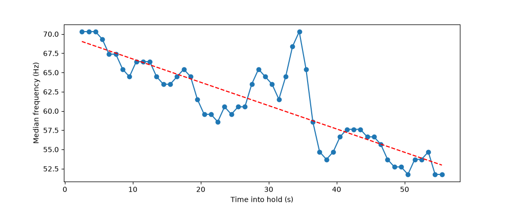

# EMG Muscle Fatigue Monitor

A surface electromyography (sEMG) system that detects muscle fatigue from the frequency content of the muscle's electrical signal. As a muscle fatigues during a sustained contraction, its fibers conduct electrical impulses more slowly, which shifts the EMG power spectrum toward lower frequencies. This project acquires raw sEMG from the biceps at 1 kHz and tracks that shift by computing the **median frequency** of the power spectrum over time.

Built from scratch: hardware integration, embedded firmware, serial data logging, and a Python signal processing pipeline.

## Result (pilot trial)

During a ~60 s sustained isometric biceps contraction held to failure, median frequency fell from **69.0 Hz to 53.0 Hz (−23.3%)**, a slope of **−0.30 Hz/s** (about −18 Hz/min). This is the downward spectral shift expected from fatigue.



*Each point is the median frequency of a 5 s window, stepped every 1 s. The dashed line is a linear fit.*

This is a single pilot trial. See [Limitations](#limitations).

## Hardware

| Component | Role |
|---|---|
| MyoWare 2.0 Muscle Sensor (RAW output) | Differential biopotential amplifier with an analog ~20–500 Hz bandpass |
| MyoWare 2.0 Link Shield + Arduino Shield | Solderless signal path from sensor to microcontroller over a TRS cable |
| Arduino Uno R4 WiFi | 14-bit ADC sampling and serial streaming |
| 24 mm disposable snap electrodes | Skin contact (MID, END, REF on the sensor board) |

Signal path: biceps → electrodes → MyoWare (RAW) → Link Shield → TRS cable → Arduino Shield → Uno R4 ADC (A0) → USB serial → laptop.

The RAW output is used rather than the sensor's envelope output, because the envelope is already rectified and smoothed, which removes the frequency information that median frequency depends on.

## Data acquisition

- **Sampling:** 1 kHz, scheduled with `micros()` so the interval doesn't drift. 14-bit ADC resolution.
- **Why 1 kHz:** the Nyquist limit at 1 kHz is 500 Hz, above the ~450 Hz upper range of surface EMG. Sampling too slowly would alias high-frequency content into the analysis band, which can't be undone afterward. The sensor's analog bandpass acts as the anti-aliasing filter.
- **Throughput:** the firmware sends one ADC value per line at 500,000 baud with no timestamp. Time is reconstructed from sample index, which is valid only because the rate is verified on every recording.
- **Logging:** `log_serial.py` reads the serial buffer in bulk during capture and parses afterward, which sustains the full rate. Every run prints its effective sampling rate. The recording analyzed here: 89,951 samples in 90.0 s (999.4 Hz).

## Protocol

- Left biceps, preacher bench, 30 lb dumbbell, sustained isometric hold to failure.
- Elbow angle **123.6° ± 1.7°** (mean ± SD of 3 measurements from a mid-hold side-profile photo, using `measure_angle.py`).
- Load chosen by pilot testing to give a ~30–60 s time to failure.
- 90 s recording: pickup, hold to failure (~60 s), then rest.

## Processing pipeline

Implemented in `analysis/pipeline.py` with NumPy, SciPy, and Matplotlib.

1. **Window:** keep 3.0–61.5 s of the recording, which excludes the pickup and release movements. Drop the first and last samples, which can be truncated serial lines.
2. **Mean removal:** subtract the ~8,150-count mid-supply bias.
3. **Bandpass:** 4th-order Butterworth, 20–450 Hz, second-order sections, applied zero-phase with `sosfiltfilt`. Below 20 Hz is mostly motion artifact and electrode drift; above 450 Hz is mostly noise.
4. **Power spectrum:** Welch's method (`nperseg = 1024`, ~1 Hz resolution).
5. **Median frequency:** the frequency that splits total power in the 20–450 Hz band in half, computed for 5 s windows every 1 s.
6. **Trend:** linear fit of median frequency against time.

**No 60 Hz notch filter.** The spectrum showed no narrow peak at 60 Hz or its harmonics, so no mains interference was present to remove. A notch at 60 Hz would also cut real EMG power near the spectral peak and bias the median frequency.

## Limitations

- **One trial.** Replication on separate days is needed before treating the result as a finding.
- **Overlapping windows.** Adjacent 5 s windows share 4 s of data, so the points aren't independent. No p-value is reported for the trend.
- **Frequency resolution.** Median frequency moves in ~1 Hz steps at this PSD resolution.
- **Unexplained bump.** Median frequency rises between ~28 and 35 s into the hold. Part of it coincides with a transient in the raw signal at ~29 s; the rest is not yet explained.
- **No pre-hold baseline.** The recording started before the weight was picked up.
- **Angle from a single 2D photo,** with no goniometer for comparison.
- **Parameter sensitivity** to window length and PSD settings has not yet been tested.

## Repository structure

```
firmware/emg_logger/      Arduino sketch (1 kHz sampling, serial output)
analysis/log_serial.py    Serial capture to CSV, with effective-rate check
analysis/check_window.py  Plots the recording edges to choose the analysis window
analysis/pipeline.py      Filtering, power spectrum, median frequency trend
analysis/measure_angle.py Elbow angle from a photo (three clicked points)
data/raw/                 Recordings (one ADC value per line, 1 kHz)
docs/lab-notebook.md      Dated engineering log, including failures and fixes
docs/Images/              Figures and the setup photo
```

## Reproducing

1. Upload `firmware/emg_logger/emg_logger.ino` to an Uno R4 WiFi, then close the Arduino IDE so the serial port is free.
2. Install dependencies: `python -m pip install numpy scipy matplotlib pyserial`
3. In `analysis/log_serial.py`, set `PORT` and `OUTPUT_FILE`, then run `python log_serial.py` from the `analysis` folder. Check that the printed effective rate is close to 1000 Hz.
4. Run `python pipeline.py` from the `analysis` folder.

Run the laptop on AC power. On battery, throttling dropped the sustained rate to ~623 Hz.

## Engineering notes

The [lab notebook](docs/lab-notebook.md) records every session, including what went wrong. Highlights:

- A sampling-rate shortfall (820 samples in 15 s, then ~750 Hz) traced to per-sample serialization and per-line parsing, fixed by dropping timestamps and buffering serial reads.
- Real recordings failing at 623, 175, and 12 Hz while stationary checks passed, traced to battery power (confirmed) and likely cable movement under load (resolved by securing cables, cause not fully isolated).
- Establishing that the sensor output was RAW rather than envelope by noticing the signal swung symmetrically around the ADC midpoint.

## Next steps

- Robustness check across window lengths and PSD settings.
- Replication trials at the same load and elbow angle.
- A notebook walkthrough of the pipeline.

*Not a medical device. The MyoWare sensor is not intended for diagnosis or treatment.*
